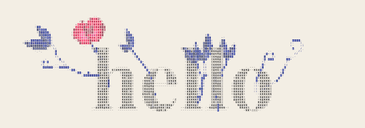

# Type Garden (ASCII)

Type, and a garden grows out of the letters, drawn entirely in text characters.

<p align="center">
  
</p>

Stems curl up out of every letter and end in flowers. Space cuts the stems so the next word grows its own garden, backspace withers, enter clears.

## Credits

**The idea is not mine.** This is a reinterpretation of **[Type Garden](https://type-garden.vercel.app/) by Akshat Agarwal**: type and stems and roses grow out of the letters, space cuts the stems, backspace withers, enter clears. The growth, the motion and the look of the stems and roses come from that original. Please go and enjoy the real thing.

What is different here: everything is re-drawn as ASCII, and the original's commercial typeface (GT Ultra Fine) is replaced by Playfair Display. This is an unofficial fan version, not affiliated with or endorsed by the original author.

Also built on the work of others:

- **[ascii-animals](https://github.com/DesignerStephen1/ascii-animals)** by drewdi / DesignerStephen1 (MIT): the cell-grid ASCII rendering approach, the liquid-glass filter and the Tweaks panel are adapted from it.
- **[ascii.rest](https://ascii.rest)**: the cherry blossom on the empty state and the poster butterfly.
- **[GSAP](https://gsap.com)** (all animation and the frame loop) and **[Lenis](https://lenis.darkroom.engineering)** (smooth scroll).
- Fonts from Google Fonts: Playfair Display, JetBrains Mono, Geist, Inter and Instrument Serif.

## Features

- **Ten flowers** (rose, tulip, daisy, poppy, blossom, lily, bell, lavender, fern, puff). **Build your own mix**: toggle any species on or off (shift-click to grow only one) and change a species' colour; flowers already on screen swap live.
- **Chaos slider**: from minimal botanical typography to the garden taking over.
- **Separate ASCII for text and flowers**: each has its own cell size.
- **Export your garden** as a clean looping **MP4**, **GIF** or PNG frames (seven motion presets), or **record** it live as you type.
- **Export**: PNG, SVG (text), and **copy-paste code** for React, HTML + Tailwind or HTML + CSS. The code embeds the whole engine, so it has no dependencies.
- **Liquid-glass UI** with a Tweaks panel. Your palette, tweaks and last words are saved in the browser.

## Make the demo GIF

Two ways, both from the Type tab:

- **Record it live**: press **● GIF** (or **● MP4**), type `ASCII Garden` and watch it bloom, then press **■ Stop**. It captures just the garden, as you made it.
- **Export a clean loop**: type your words, pick a motion preset in Tweaks (**Typed** types, cuts and repeats; **Grow & wither** blooms and fades), then **Export ▾ → GIF loop**. It renders a 600 x 600, 20 fps loop. The same menu also makes a 1080 x 1080 **MP4** and **PNG frames**.

The Poster tab has the same exports. Save the GIF as `docs/demo.gif`.

## Run it

```sh
npm install
npm run dev      # http://localhost:5173
npm run build    # type-checks and builds to dist/
```

`npm run dev` and `npm run build` first run `npm run gen`, which bundles the dependency-free engine (`src/standalone/engine.min.js`) that the code export pastes into its snippets.

## Controls

| | |
| --- | --- |
| type | grow letters (or tap, on a phone) |
| space | cut the stems |
| backspace | wither the last letter |
| enter | clear |
| click | a butterfly lands on a flower |
| double-click | plant a rose |

## How it works

The garden is drawn with ordinary vector calls onto a hidden low-resolution canvas. Each character cell of that picture is then turned into text: solid areas become a block of colour with a dense glyph, thin shapes such as stems become line glyphs that follow their angle (`- \ | /`), and partly covered cells become soft edge glyphs. Shading uses dark, base and light tones of each colour, which map to dense, medium and sparse glyphs. The flowers and the type are separate layers on their own grids, which is why their sizes are independent.

```
src/engine/garden.ts      growth, motion, species, poster
src/engine/ascii.ts       the canvas-to-characters rasterizer
src/standalone/entry.ts   the dependency-free build used by the code export
src/export/               code generators and the syntax highlighter
src/components/           liquid glass filter, Tweaks panel, glass switch
```

## License

MIT, see [LICENSE](LICENSE). The original Type Garden and the projects credited above keep their own licences and copyrights.
